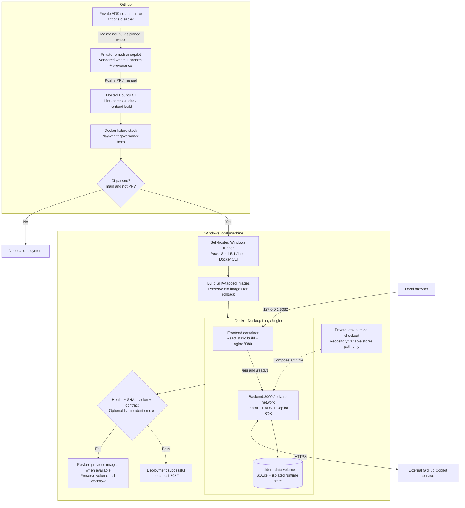
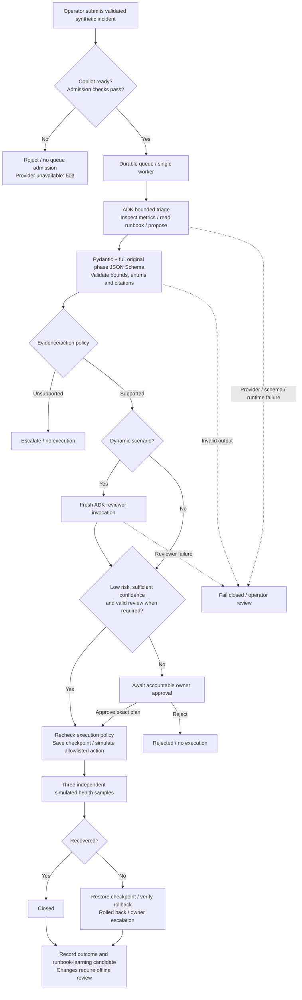

# RemediAI Copilot - editable diagrams

Baseline: deployed commit `bec87e8`, 26 October 2026.
Scope: `remedi-ai-copilot` only. Real ADK orchestration and Copilot inference;
all infrastructure effects are simulated. These diagrams are not a claim of
production certification or live integrations with monitoring/ITSM platforms.

Open [the offline diagram viewer](index.html) for vector renderings.
The Mermaid sources below render directly on GitHub and in Mermaid-capable editors.

## 1. Solution architecture

```mermaid
flowchart LR
  subgraph LOCAL["Local machine / application trust boundary"]
    OP["Operator: submit synthetic incidents"]
    OWNER["Accountable owner: approve / reject"]
    UI["React / TypeScript console<br/>nginx - localhost:8082"]
    API["FastAPI<br/>Auth, schemas, limits, idempotency"]
    ENGINE["Single asynchronous worker"]
    DB[("SQLite persistent volume<br/>Queue, state, audit, feedback")]
    ADK["Google ADK Runner / LlmAgent<br/>Bounded evidence-action loop"]
    TOOLS["Native read-only functions<br/>inspect_metrics / read_runbook"]
    REVIEW["Dynamic cases only<br/>Fresh ADK reviewer invocation"]
    SDK["Custom BaseLlm bridge<br/>Copilot SDK / JSON-RPC runtime"]
    POLICY["Deterministic policy<br/>Risk, confidence, evidence, review"]
    SIM["Allowlisted simulator<br/>Checkpoint / action / 3 probes"]
    OP --> UI
    OWNER --> UI
    UI <-->|REST / authenticated SSE| API
    API --> DB
    DB -->|Queued job| ENGINE
    ENGINE --> ADK
    ADK <-->|Observed evidence| TOOLS
    ADK <-->|Typed inference| SDK
    ADK --> POLICY
    POLICY -->|Dynamic, not escalated| REVIEW
    REVIEW <-->|Same model, fresh session| SDK
    REVIEW --> POLICY
    POLICY -->|Owner gate when required| UI
    POLICY -->|Eligible / owner approved| SIM
    ENGINE -->|Decisions / telemetry| DB
    SIM -->|Outcome / learning candidate| DB
  end
  SERVICE["GitHub Copilot service<br/>claude-sonnet-5 baseline"]
  SDK <-->|HTTPS / synthetic evidence only| SERVICE
```

The SDK receives no model tools, shell, filesystem, host Git, skills or MCP access.
Only deterministic application policy can permit an action. Dynamic review uses
the same model in a fresh invocation, not an independent expert or separate provider.
The database has append-only audit triggers, not off-host tamper-proof storage.

## 2. Technical deployment and CI/CD

Baseline runtime: Python 3.12, React 19, Node 22.20 build, Copilot SDK 1.0.25,
private ADK 2.12.0+remedi.1 and OpenTelemetry API/SDK 1.45.1.
Normal dependency resolution and hashed runtime restores apply. The local-version
ADK artifact is verified and its upstream base is separately audited.

CI uses disposable fixture credentials; it receives no personal Copilot secret.
Only trusted main deployments use the local runner. The optional live smoke
consumes subscription allowance and creates a synthetic low-risk incident;
it does not approve high-impact changes. Image rollback is not database rollback.

## 3. Incident workflow

High-impact worker/capacity changes remain owner-gated regardless of confidence.
Reviewer disagreement or low confidence also requires the owner. No model can
assert recovery, approve a change or grant itself additional privileges.

## Implementation references

- [Architecture and scope](../ARCHITECTURE.md)
- [ADK orchestration](../ADK_DYNAMIC.md)
- [CI/CD and maintenance](../CICD.md)
- [Compose topology](../../compose.yaml)
- [Agent engine](../../backend/app/engine.py)
- [ADK bridge](../../backend/app/adk_runtime.py)
- [Copilot adapter and schema boundary](../../backend/app/copilot_provider.py)
- [Actions pipeline](../../.github/workflows/pipeline.yml)
- [Deployment and rollback](../../scripts/deploy.ps1)

The original `AI_Remedy_1` and `AI_Remedy_2` concepts map to triage, the approved
risk boundary, owner approval, execution, verification, rollback, audit and
reviewed learning. No automatic runbook deployment or real-system self-healing
is implied by the diagrams.
